


<!-- Typing animation -->

 

<!-- Social badges -->

  

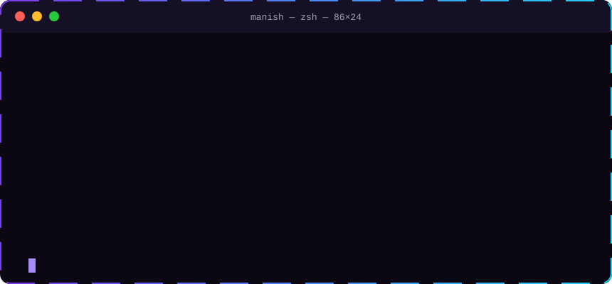

 


 

<!-- Static icon rack (always renders crisp) -->

<table>
<tr>
<td><a href="https://github.com/KManish-1406?tab=repositories"></a></td>
<td><a href="https://github.com/KManish-1406?tab=repositories"></a></td>
</tr>
<tr>
<td></td>
<td><a href="https://github.com/KManish-1406?tab=repositories"></a></td>
</tr>
<tr>
<td><a href="https://github.com/KManish-1406?tab=repositories"></a></td>
<td><a href="https://github.com/KManish-1406?tab=repositories"></a></td>
</tr>
</table>



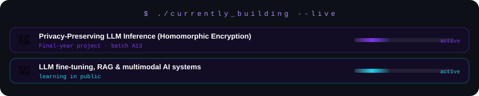

 

 

 

👨‍💻 **Actively seeking Software Developer & AI Engineer roles — let's talk!**

 

  

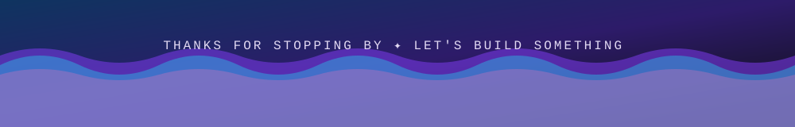

